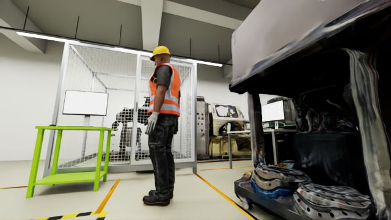
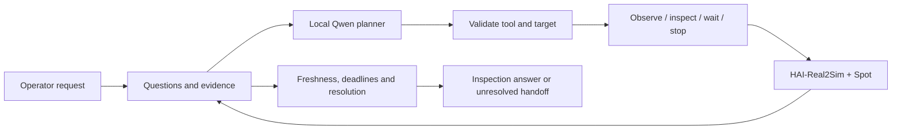

# TRACE

**Task-Relevant Active Context and Evidence**

TRACE is an agent harness for robot-assisted visual inspection. A local vision-language model chooses where to look and when to move; the host tracks which questions the resulting images actually answer.

The current implementation connects **Spot in HAI-Real2Sim**, **Isaac Sim 6.2**, and **Qwen3-VL 8B**. Simulation runs on an RTX 5090 PC and model inference runs on DGX Spark. The orchestration is native Python `asyncio`, with separate planner and inspection-tool interfaces. The Python package is `tracebot` (`trace` is a standard-library module). TRACE was previously called HAI-CLAW, and that name survives in dated reports, saved run snapshots and some runtime identifiers.



*An actual body-camera frame from the October 27 development runs. Scene reconstruction is provided by [HAI-Real2Sim](https://github.com/sayhee-kim/HAI-Real2Sim); TRACE adds the inspection loop and evidence handling.*

## What it does

An operator asks the robot to check a worker. The model can observe a configured camera, inspect a named viewpoint, wait, stop, or hand off an unresolved request. Each observation carries its source, capture time and frame reference. The host rejects stale or unrelated evidence and keeps the execution within movement, tool-call and time budgets.

Finding a person is not enough to declare the workplace safe. Presence and visible posture are separate questions. A completed inspection request can still leave the overall incident unresolved. The model cannot directly assign a safety verdict or send arbitrary coordinates to the robot.



Spot follows configured corridors using Isaac Sim's locomotion policy. This Real2Sim path does not use Nav2. The older ROS 2/Nav2 experiment remains available as a separate integration.

## Current status

Everything below is simulation in one reconstructed lab with authored worker poses. Counts are small development cohorts, not a benchmark.

| What was checked | Result |
|---|---|
| Spot patrol in the reconstructed lab | 23/23 waypoints; movement cancellation and entrance arrival exercised |
| Model-directed inspection, live Isaac + Qwen | Runs end in an inspection answer or an explicit unresolved handoff |
| Software contracts | 330 CPU tests, no GPU or model needed; CI on Python 3.11 and 3.12 |
| Person-detector gate OFF vs ON, 20 conditions per arm | See below |

### Does the cited frame support the answer?

A posture label can match the truth while the cited frame does not show the worker. The comparison therefore scores an answer only when it is correct **and** the cited frame contains the target. Both arms use the same Qwen planner, prompts, tools and budgets; the ON arm adds a YOLO11n person-detector veto (confidence 0.60).

| November 9 rerun, 20 runs per arm | Gate OFF | Gate ON |
|---|---:|---:|
| Correct and supported by the cited frame | 11/20 | 13/20 |
| Posture asserted with the target absent from the frame | 3/20 | 0/20 |
| Handoff in the four unanswerable conditions | 3/4 | 4/4 |
| Mean wall time | 247.6 s | 286.1 s |

What this does and does not show:

- The 11 → 13 difference is within what 20 runs can produce by chance. The clearer change is that unsupported assertions disappeared, at the cost of longer runs.
- This is a rerun on conditions already used for diagnosis, after a host-rule fix applied to both arms. It is not a held-out confirmation.
- In the first 40-run cohort (November 8) the same measure was 4/20 vs 6/20: an over-strict host rule blocked readable frames in both arms. Those results are kept and reported separately.
- The detector also fires on lab equipment and misses some lying poses, so it is a veto, not a verifier of identity or posture.
- An earlier ten-run pilot (November 7) against fixed-order verification did not show an advantage for TRACE.

Dynamic falls, held-out scenes, independent grounding assessment and durable crash recovery remain open. Authored lying poses are not physical falls or injury diagnoses.

### Reports

| Date | Topic | Document |
|---|---|---|
| Oct 27 | Integration runs and setup | [RTX 5090 setup](reports/RTX5090_SETUP.md), [work log](reports/WORKLOG.md) |
| Nov 7 | Pilot against fixed-order verification | [findings](reports/COMPARISON_FINDINGS_20261107.md), [protocol](reports/COMPARISON_PROTOCOL.md), [metrics](reports/COMPARISON_METRICS.md) |
| Nov 8 | Detector gate and human audit of 61 frames | [findings](reports/DETECTOR_GATE_FINDINGS_20261108.md), [human audit](reports/PERSON_DETECTOR_HUMAN_AUDIT_20261108.md), [protocol](reports/DETECTOR_GATE_PROTOCOL.md) |
| Nov 8 | First 40-run cohort | [pre-registered plan](reports/DETECTOR_GATE_COHORT_20261108.md) |
| Nov 9 | Host-rule fix and paired rerun | [rerun protocol](reports/SCOPED_LIMITATIONS_RERUN_20261109.md) |
| Nov 11 | Result figures and number sources | [presentation outline](reports/KSME_2026_SLIDE_CONTENTS_V2.md), [slide assets](artifacts/ksme_slide_package_20261111/) |

Raw frames, source snapshots and per-run records stay local under `artifacts/comparisons/`. The runner is [run_real2sim_comparison.py](scripts/run_real2sim_comparison.py); it refuses silent overwrites and source or model changes during a cohort.

## Try the core without a simulator

```bash
git clone https://github.com/juhwan0423/TRACE.git
cd TRACE
PYTHONPATH=src python3 -B -m unittest discover -s tests -v
python3 scripts/run_harness.py --mode fixture --planner fixture --fail-first
python3 scripts/demo_context_resolution.py
```

The fixture exercises failure handling and context resolution without a GPU or model. Its outputs are software checks, not live robot results. Python 3.11 or newer is required; some tests also need `numpy` and `pillow`.

## Run with Real2Sim

First prepare the scene assets, Isaac Sim environment and model endpoint described in [RTX 5090 setup](reports/RTX5090_SETUP.md). They are not included in this repository. The launch scripts currently target the development workstation; review paths before using another machine.

```bash
bash scripts/start_spark_tunnel.sh <Spark-Tailscale-IP>
bash scripts/start_trace_real2sim_5090.sh
```

The desktop monitor's **agent execution** tab starts and stops the harness. For a terminal run, after the monitor reports that Spot is ready:

```bash
PYTHONPATH=src .venv/bin/python scripts/run_real2sim_harness.py --camera-policy body-only
```

Each run saves events, images, a result and a source/configuration snapshot under `artifacts/harness/`. Full run artifacts stay local. A run can finish by handing off uncertainty; `completed=true` alone does not mean a successful safety assessment.

For an authored **visible → occluded worker → Spot inspection** development scenario,
with the monitor and Spark tunnel already running:

```bash
PYTHONPATH=src .venv/bin/python scripts/demo_real2sim_occlusion.py
```

This uses actual Qwen camera observations to trigger inspection and preserves the original scene through reversible runtime overrides. See the [scenario instructions and validation limits](reports/OCCLUDED_WORKER_SCENARIO.md). It is not a YOLO baseline or a fixed-patrol speed comparison.

## Read the implementation

| Area | Entry point |
|---|---|
| Bounded execution and host decisions | [harness.py](src/tracebot/harness.py) |
| Questions and evidence lifecycle | [context.py](src/tracebot/context.py) |
| Local model planner | [harness_planner.py](src/tracebot/providers/harness_planner.py) |
| Real2Sim tool adapter | [real2sim_harness_tools.py](scripts/real2sim_harness_tools.py) |
| Corridor navigation | [real2sim_navigation.py](scripts/real2sim_navigation.py) |
| Repeated trials | [repeat_real2sim_trials.py](scripts/repeat_real2sim_trials.py) |
| Research assumptions | [Context method decisions](reports/CONTEXT_METHOD_DECISIONS.md) |

[Original requirements](implementation_guide.md) · [Earlier Nav2 setup](reports/SPARK_SETUP.md) · [Previous README](reports/README_BEFORE_REAL2SIM.md)

[Dated architecture proposals](docs/architecture/README.md) track design changes separately from implementation and validation status.

TRACE is a simulation research prototype. No real robot or emergency service is connected. The code in this repository is released under the [MIT License](LICENSE). Dependencies, model weights and scene assets keep their own terms; in particular the optional person detector uses Ultralytics YOLO, which is AGPL-3.0.
