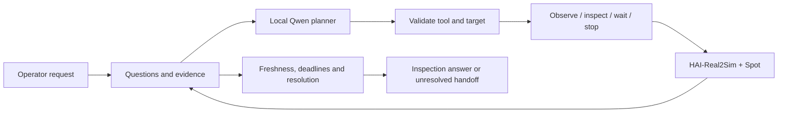

# TRACE

**Task-Relevant Active Context and Evidence**

TRACE is an agent harness for robot-assisted visual inspection. A local vision-language model chooses where to look and when to move; the host tracks which questions the resulting images actually answer.

The current implementation connects **Spot in HAI-Real2Sim**, **Isaac Sim 6.2**, and **Qwen3-VL 8B**. Simulation runs on an RTX 5090 PC and model inference runs on DGX Spark. The orchestration is native Python `asyncio`, with separate planner and inspection-tool interfaces. TRACE was previously called HAI-CLAW; the Python package is still named `haiclaw`.


*An actual body-camera frame from the October 27 development runs. Scene reconstruction is provided by [HAI-Real2Sim](https://github.com/sayhee-kim/HAI-Real2Sim); TRACE adds the inspection loop and evidence handling.*

## What it does

An operator asks the robot to check a worker. The model can observe a configured camera, inspect a named viewpoint, wait, stop, or hand off an unresolved request. Each observation carries its source, capture time and frame reference. The host rejects stale or unrelated evidence and keeps the execution within movement, tool-call and time budgets.

Finding a person is not enough to declare the workplace safe. Presence and visible posture are separate questions. A completed inspection request can still leave the overall incident unresolved. The model cannot directly assign a safety verdict or send arbitrary coordinates to the robot.



Spot follows configured corridors using Isaac Sim's locomotion policy. This Real2Sim path does not use Nav2. The older ROS 2/Nav2 experiment remains available as a separate integration.

## Verified so far

| Check | Observed result |
|---|---|
| Spot patrol in the reconstructed lab | 23/23 waypoints completed; movement cancellation and entrance arrival also exercised |
| Model-directed, body-camera-only inspection | Two final development runs: one viewpoint move and one new observation each; 42.4 s and 54.3 s wall time; no tool errors |
| Fixed and body cameras available | One final run answered the inspection questions from a fixed-camera observation in 47.2 s |
| Evidence and execution contracts | 122 CPU regression tests at the October 27 checkpoint |

These October checks are integration evidence in a standing-worker scene, not a perception benchmark. Earlier and later timing runs changed prompts and guards, so they do not establish a single-factor speedup. See [validation notes](reports/RTX5090_SETUP.md) and the [work log](reports/WORKLOG.md).

### November 7 development comparison

Ten live Isaac/Qwen executions compared fixed-order verification with TRACE across five posture/coverage variants in three placements of this lab. All planned executions were retained, including unresolved inspections and internal failures. This pilot **does not demonstrate an advantage for TRACE**.

| Saved measure | Fixed order | TRACE |
|---|---:|---:|
| Correct posture label in answerable cases | 2/3 | 1/3 |
| Posture assertion in unanswerable cases | 1/2 | 1/2 |
| Mean wall time, all five executions | 269.17 s | 418.33 s |

Correct labels do not establish visual support: a separate, unblinded assistant visual audit found support for only two of the five asserted posture answers. One fixed-order label match came from a frame with no identifiable worker. This audit is not independent human annotation. Gate drive phase/physical state were not controlled, a later closure diagnostic failed, and the north route had a marginal-clearance failure, so the pilot is not a clean causal policy comparison.

See the [comparison findings](reports/COMPARISON_FINDINGS_20261107.md), [frozen-run protocol](reports/COMPARISON_PROTOCOL.md), and [metric definitions](reports/COMPARISON_METRICS.md). Raw frames, source snapshots, records and rendered summaries remain local under `artifacts/comparisons/20261107_development_01/`. The runner is [run_real2sim_comparison.py](scripts/run_real2sim_comparison.py); it refuses silent overwrites and source/model changes during a cohort.

Held-out, matched-reset comparisons, independent grounding assessment, repeated loss-triggered trials, dynamic fall validation and durable crash recovery remain open. The authored lying poses in this pilot are not physical falls or injury diagnoses.

### November 8 independent detector gate

An opt-in RGB person detector now vetoes uncorroborated posture interpretations before they reach the host. The two new comparison arms, `agent_gate_off` and `agent_gate_on`, use the same Qwen planner, full-frame vision request, tools and existing evidence rules. Only the additional detector veto differs. Simulator truth is reserved for offline evaluation; detection does not verify identity or posture.

**Human annotation update:** the researcher has now labeled all 61 frames. At confidence 0.25 and IoU ≥ 0.5, target-box recall is 6/7 (lying: 3/4), while 37/54 target-not-visible frames have person detections and 24/54 pass the single-candidate gate. One lying detection covers the worker but has an undersized box (IoU 0.422). This gate is not ready for the planned policy comparison. Confidence 0.60 reduces the cached-data false-positive count to 3/54 without further recall loss here, but needs new-frame validation. See the [completed human audit](reports/PERSON_DETECTOR_HUMAN_AUDIT_20261108.md). No runtime threshold was changed.

The fixed YOLO11n development configuration processed all 61 archived frames: 31 had one person candidate, 13 had multiple candidates and 17 had none. No detector execution failed. However, laboratory equipment also produced false person candidates. A presence-only rule would pass all three previously audited unsupported assertions; the implemented single-candidate rule rejects their ambiguous detections. This is a development observation, not a measured reduction in online errors. Two fresh Qwen calls on saved images verified integration; no new closed-loop comparison has run.

See [implementation and findings](reports/DETECTOR_GATE_FINDINGS_20261108.md) and the [two-arm evaluation protocol](reports/DETECTOR_GATE_PROTOCOL.md). The suite currently passes 265 tests. Paired scene reset, exact-frame evaluation labels, independent posture review and the proposed 40 executions remain to be completed.

## Try the core without a simulator

```bash
git clone https://github.com/juhwan0423/TRACE.git
cd TRACE
PYTHONPATH=src python3 -B -m unittest discover -s tests -v
python3 scripts/run_harness.py --mode fixture --planner fixture --fail-first
python3 scripts/demo_context_resolution.py
```

The fixture exercises failure handling and context resolution without a GPU or model. Its outputs are software checks, not live robot results.

## Run with Real2Sim

First prepare the scene assets, Isaac Sim environment and model endpoint described in [RTX 5090 setup](reports/RTX5090_SETUP.md). They are not included in this repository. The launch scripts currently target the development workstation; review paths before using another machine.

```bash
bash scripts/start_spark_tunnel.sh <Spark-Tailscale-IP>
bash scripts/start_trace_real2sim_5090.sh
```

The desktop monitor's **agent execution** tab starts and stops the harness. For a terminal run, after the monitor reports that Spot is ready:

```bash
PYTHONPATH=src .venv/bin/python scripts/run_real2sim_harness.py --camera-policy body-only
```

Each run saves events, images, a result and a source/configuration snapshot under `artifacts/harness/`. Full run artifacts stay local. A run can finish by handing off uncertainty; `completed=true` alone does not mean a successful safety assessment.

For an authored **visible → occluded worker → Spot inspection** development scenario,
with the monitor and Spark tunnel already running:

```bash
PYTHONPATH=src .venv/bin/python scripts/demo_real2sim_occlusion.py
```

This uses actual Qwen camera observations to trigger inspection and preserves the original scene through reversible runtime overrides. See the [scenario instructions and validation limits](reports/OCCLUDED_WORKER_SCENARIO.md). It is not a YOLO baseline or a fixed-patrol speed comparison.

## Read the implementation

| Area | Entry point |
|---|---|
| Bounded execution and host decisions | [harness.py](src/haiclaw/harness.py) |
| Questions and evidence lifecycle | [context.py](src/haiclaw/context.py) |
| Local model planner | [harness_planner.py](src/haiclaw/providers/harness_planner.py) |
| Real2Sim tool adapter | [real2sim_harness_tools.py](scripts/real2sim_harness_tools.py) |
| Corridor navigation | [real2sim_navigation.py](scripts/real2sim_navigation.py) |
| Repeated trials | [repeat_real2sim_trials.py](scripts/repeat_real2sim_trials.py) |
| Research assumptions | [Context method decisions](reports/CONTEXT_METHOD_DECISIONS.md) |

[Original requirements](implementation_guide.md) · [Earlier Nav2 setup](reports/SPARK_SETUP.md) · [Previous README](reports/README_BEFORE_REAL2SIM.md)

[Dated architecture proposals](docs/architecture/README.md) track design changes separately from implementation and validation status.

TRACE is a simulation research prototype. No real robot or emergency service is connected. A repository license has not yet been selected; dependencies and scene assets retain their own terms.
