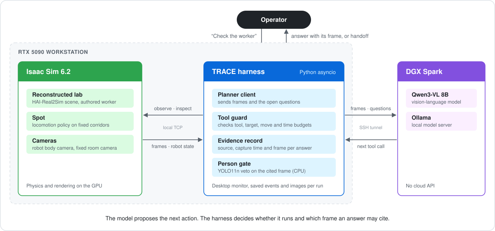
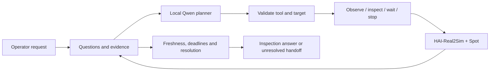

# TRACE

[](https://github.com/juhwan0423/TRACE/actions/workflows/tests.yml)


**Task-Relevant Active Context and Evidence.** A robot inspection agent that has to show the camera frame behind each answer.

| | |
|---|---|
| Built | A simulated Spot robot checks on a worker when an operator asks. A local vision-language model picks where to look and when to move. The host program validates each action and records which frame supports the answer. |
| Stack | Isaac Sim 6.2, Python `asyncio`, Qwen3-VL 8B on Ollama, YOLO11n. Simulation on an RTX 5090 PC, model inference on a DGX Spark, connected by an SSH tunnel. |
| Result | In 20 test conditions run with and without a person-detector check, the check removed every posture answer whose cited frame did not show the worker (3 → 0). Correct answers backed by their frame went from 11 to 13. |

https://github.com/user-attachments/assets/79563b4e-c37d-407b-aeb1-a65cc7d94959

*34.5 s demo of one four-minute simulated inspection, redrawn from its saved records and sped up (not a screen capture). It is a separate demonstration run, not one of the comparison runs below. [Video file](docs/assets/trace_demo_monitor_en.mp4).*

## System



The harness sits between the model and the robot. The model only sees camera frames and the questions still open, and it replies with one tool call. The harness checks that call against the allowed tools, named viewpoints and budgets before anything moves. Scene reconstruction comes from [HAI-Real2Sim](https://github.com/sayhee-kim/HAI-Real2Sim).

## How an inspection runs

An operator asks the robot to check a worker. The model can observe a camera, inspect a named viewpoint, wait, stop, or hand off a request it cannot resolve. Each observation carries its source, capture time and frame reference. The host rejects stale or unrelated evidence and enforces movement, tool-call and time budgets.

Presence and visible posture are separate questions, so finding a person does not make the workplace safe. The model cannot assign a safety verdict or send arbitrary coordinates to the robot.




*Body-camera frame from a development run. Spot follows configured corridors with Isaac Sim's locomotion policy.*

## Results

All results are from simulation in one reconstructed lab with authored worker poses. The cohorts are small.

| What was checked | Result |
|---|---|
| Spot patrol in the reconstructed lab | 23/23 waypoints, with movement cancellation and entrance arrival exercised |
| Model-directed inspection, live Isaac + Qwen | Runs end in an inspection answer or an explicit unresolved handoff |
| Software contracts | 330 CPU tests, no GPU or model needed, CI on Python 3.11 and 3.12 |
| Person-detector gate OFF vs ON, 20 conditions per arm | Table below |

### Does the cited frame support the answer?

A posture label can be right while the cited frame does not show the worker. An answer therefore counts only if it is correct and its cited frame contains the target. Both arms use the same Qwen planner, prompts, tools and budgets. The ON arm adds a YOLO11n person-detector veto at confidence 0.60.

| November 9 rerun, 20 runs per arm | Gate OFF | Gate ON |
|---|---:|---:|
| Correct and supported by the cited frame | 11/20 | 13/20 |
| Posture asserted with the target absent from the frame | 3/20 | 0/20 |
| Handoff in the four unanswerable conditions | 3/4 | 4/4 |
| Mean wall time | 247.6 s | 286.1 s |

Limits:

- 11 vs 13 is within chance for 20 runs. Unsupported assertions went from 3 to 0, and runs took about 39 s longer.
- The rerun used conditions already seen during diagnosis, after a host-rule fix applied to both arms. There is no held-out confirmation yet.
- The first 40-run cohort (November 8) scored 4/20 vs 6/20 because an over-strict host rule blocked readable frames in both arms. Those results are reported separately.
- The detector fires on lab equipment and misses some lying poses, so it works only as a veto.
- A ten-run pilot (November 7) against fixed-order verification showed no advantage for TRACE.
- Not yet tested: dynamic falls, held-out scenes, independent grounding assessment, crash recovery. Lying poses are authored, not physical falls.

### Reports

| Date | Topic | Document |
|---|---|---|
| Oct 27 | Integration runs and setup | [RTX 5090 setup](reports/RTX5090_SETUP.md), [work log](reports/WORKLOG.md) |
| Nov 7 | Pilot against fixed-order verification | [findings](reports/COMPARISON_FINDINGS_20261107.md), [protocol](reports/COMPARISON_PROTOCOL.md), [metrics](reports/COMPARISON_METRICS.md) |
| Nov 8 | Detector gate and human audit of 61 frames | [findings](reports/DETECTOR_GATE_FINDINGS_20261108.md), [human audit](reports/PERSON_DETECTOR_HUMAN_AUDIT_20261108.md), [protocol](reports/DETECTOR_GATE_PROTOCOL.md) |
| Nov 8 | First 40-run cohort | [pre-registered plan](reports/DETECTOR_GATE_COHORT_20261108.md) |
| Nov 9 | Host-rule fix and paired rerun | [rerun protocol](reports/SCOPED_LIMITATIONS_RERUN_20261109.md) |
| Nov 11 | Result figures and number sources | [presentation outline](reports/KSME_2026_SLIDE_CONTENTS_V2.md), [slide assets](artifacts/ksme_slide_package_20261111/) |

Raw frames and per-run records stay local under `artifacts/comparisons/`. The runner is [run_real2sim_comparison.py](scripts/run_real2sim_comparison.py). It refuses to overwrite earlier runs or to continue a cohort after the source or model changes.

## Try the core without a simulator

```bash
git clone https://github.com/juhwan0423/TRACE.git
cd TRACE
PYTHONPATH=src python3 -B -m unittest discover -s tests -v
python3 scripts/run_harness.py --mode fixture --planner fixture --fail-first
python3 scripts/demo_context_resolution.py
```

The fixture exercises failure handling and context resolution without a GPU or model. It needs Python 3.11 or newer, and some tests need `numpy` and `pillow`.

## Run with Real2Sim

Scene assets, the Isaac Sim environment and the model endpoint are not in this repository. [RTX 5090 setup](reports/RTX5090_SETUP.md) describes them. The launch scripts target the development workstation, so check the paths before using another machine.

```bash
bash scripts/start_spark_tunnel.sh <Spark-Tailscale-IP>
bash scripts/start_trace_real2sim_5090.sh
```

The desktop monitor's **agent execution** tab starts and stops the harness. For a terminal run, after the monitor reports that Spot is ready:

```bash
PYTHONPATH=src .venv/bin/python scripts/run_real2sim_harness.py --camera-policy body-only
```

Each run saves events, images, a result and a source/configuration snapshot under `artifacts/harness/`. A run can finish by handing off uncertainty, so `completed=true` alone does not mean a successful safety assessment.

For the **visible → occluded worker → Spot inspection** scenario, with the monitor and Spark tunnel already running:

```bash
PYTHONPATH=src .venv/bin/python scripts/demo_real2sim_occlusion.py
```

The scenario changes the scene through reversible runtime overrides. See the [scenario instructions and validation limits](reports/OCCLUDED_WORKER_SCENARIO.md).

## Code

The Python package is `tracebot`.

| Area | Entry point |
|---|---|
| Bounded execution and host decisions | [harness.py](src/tracebot/harness.py) |
| Questions and evidence lifecycle | [context.py](src/tracebot/context.py) |
| Local model planner | [harness_planner.py](src/tracebot/providers/harness_planner.py) |
| Real2Sim tool adapter | [real2sim_harness_tools.py](scripts/real2sim_harness_tools.py) |
| Corridor navigation | [real2sim_navigation.py](scripts/real2sim_navigation.py) |
| Repeated trials | [repeat_real2sim_trials.py](scripts/repeat_real2sim_trials.py) |
| Design decisions | [context method](reports/CONTEXT_METHOD_DECISIONS.md), [architecture notes](docs/architecture/README.md), [original requirements](implementation_guide.md) |

## License

[MIT](LICENSE) for the code in this repository. TRACE is a simulation research prototype with no real robot or emergency service connected. Dependencies, model weights and scene assets keep their own terms. The optional person detector uses Ultralytics YOLO, which is AGPL-3.0.
