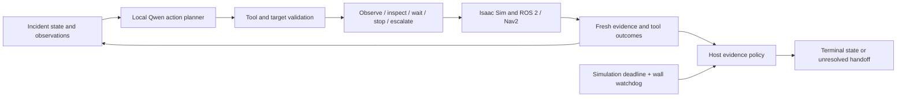

# TRACE

**An experimental agent harness for active visual inspection in simulation.**

TRACE maintains unresolved person-loss incidents and lets a local model select observations and robot inspection actions within a bounded budget. Isaac Sim supplies images and physics, ROS 2/Nav2 supplies navigation, and Qwen3-VL supplies visual observations and structured action choices. Host-side evidence checks and deadlines control incident closure.

> Research prototype, not a validated safety system. Simulation only; no real robot or external emergency service. The Python package remains `haiclaw` for compatibility with the earlier HAI-CLAW code.

## Current status

| Component | Evidence / limitation |
|---|---|
| Model-directed harness | Observe, inspect, wait, stop and unresolved handoff; bounded memory, tool validation, replanning, cancellation and logs |
| Live integration | Real Qwen selected 8 actions in one completed Isaac/Nav2 run; one viewpoint reached, another navigation failed, then re-observation and budget-triggered unresolved handoff |
| Latest guards | Post-arrival observation gate and failed-viewpoint correction have contract/model-probe verification; a full live rerun of the final version is pending |
| Tests | 86 local CPU contract/regression tests passed; these do not establish perception accuracy or physical safety |
| Baseline | Fixed-sequence runner preserved separately from the agent harness |
| Research conclusions | No controlled baseline superiority result, no validated normal-case safe closure, no VSS runtime benchmark |

Selected development evidence is summarized in [checkpoint.json](reports/evidence/checkpoint.json). These runs are not a benchmark dataset. Detailed readiness assessment: [research checkpoint](reports/RESEARCH_CHECKPOINT.md).

## Quick start: no GPU, model or simulator required

Python 3.10+:

```bash
git clone https://github.com/juhwan0423/TRACE.git
cd TRACE
PYTHONPATH=src python3 -B -m unittest discover -s tests -v
python3 scripts/run_harness.py --mode fixture --planner fixture --fail-first
```

This uses a fixture planner and fixture tools. It validates software contracts, not real model reasoning or navigation. Runs are written to `artifacts/harness/<episode>/`.

## Local model and live simulation

Validated development machine: DGX Spark / Ubuntu 24.04 ARM64, Isaac Sim 6.2.0, ROS 2 Jazzy/Nav2, Ollama with `qwen3-vl:8b`. Installation is separate: see [Spark setup](reports/SPARK_SETUP.md). Model weights, Isaac Sim, Docker images and the local Python environment are not bundled.

With the environment already prepared:

```bash
source scripts/env_spark.sh
# Review NVIDIA's Isaac Sim EULA and set this only after accepting it:
export OMNI_KIT_ACCEPT_EULA=YES
python scripts/prepare_closed_loop.py
python scripts/run_harness.py --mode live --planner ollama
```

The live runner starts a new scenario in the owned TRACE experiment stage. It refuses unrelated workspaces and concurrent baseline/harness runs. Save any experiment edits before starting. Current live scenario coverage is limited; see [harness verification](reports/HARNESS.md).

Real Qwen with simulated tools:

```bash
source scripts/env_spark.sh
python scripts/run_harness.py --mode fixture --planner ollama --fail-first
```

This is still **fixture-assisted**, not a live robotics experiment. The text planner uses a template validated specifically for the installed `qwen3-vl:8b`; changing models requires adapter validation.

## Desktop monitor

```bash
./scripts/trace_desktop.sh
```

Uses system Python with GTK 3/PyGObject, GdkPixbuf/cairo and Graphviz (`dot`), a desktop display, and a prepared Isaac session. Tabs show the scene/Qwen output, discovered ROS graph, system architecture, and agent execution. The agent tab provides start/stop controls; it does not install missing runtime dependencies.

The earlier browser presentation is a separately managed Sites checkout and is not included in this repository snapshot. The native monitor is included.

## Architecture



The planner does not execute arbitrary code or arbitrary coordinates and cannot directly declare safe/danger. Candidate viewpoints are configured in `configs/harness.json`. Camera inference is Python/local HTTP, not a ROS camera topic pipeline. Robot localization uses simulator ground truth and obstacle scans use PhysX collision rays.

## Repository guide

- `src/haiclaw/harness.py`: state, bounded tool loop and host guards.
- `src/haiclaw/providers/harness_planner.py`: local structured action planner.
- `scripts/harness_live_tools.py`: owned Isaac/ROS tool implementations.
- `scripts/run_harness.py`: fixture/live experiment entry point.
- `scripts/run_closed_loop.py`: fixed-sequence baseline.
- `scripts/trace_desktop.py`: GTK monitor.
- `tests/`: CPU contract/regression tests; CI does not run Isaac, Ollama or GTK.
- [Requirements](implementation_guide.md), [harness](reports/HARNESS.md), [baseline](reports/CLOSED_LOOP.md), [work log](reports/WORKLOG.md), [VSS desk comparison](reports/VSS_COMPARISON.md).

Historical reports and captures remain available; the [previous README](reports/LEGACY_README_2026-10-27.md) records earlier-machine commands and superseded status. Local-only artifact links in reports will not resolve in a fresh clone. Selected checkpoint summaries are tracked; full execution images/logs remain local.

## Research and reuse

Start with bounded pilot/debug experiments. Before publication-grade comparison, complete the gates in [RESEARCH_CHECKPOINT.md](reports/RESEARCH_CHECKPOINT.md). Do not interpret `completed=true` as task correctness: an unresolved handoff is a completed incident too.

A project license has not yet been selected. Do not infer open-source reuse permissions from repository visibility; dependencies and assets retain their respective licenses.
