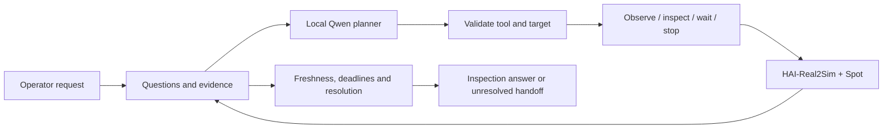

# TRACE

**Task-Relevant Active Context and Evidence**

TRACE is an agent harness for robot-assisted visual inspection. A local vision-language model chooses where to look and when to move; the host tracks which questions the resulting images actually answer.

The current implementation connects **Spot in HAI-Real2Sim**, **Isaac Sim 6.2**, and **Qwen3-VL 8B**. Simulation runs on an RTX 5090 PC and model inference runs on DGX Spark. The orchestration is native Python `asyncio`, with separate planner and inspection-tool interfaces. TRACE was previously called HAI-CLAW; the Python package is still named `haiclaw`.


*An actual body-camera frame from the October 27 development runs. Scene reconstruction is provided by [HAI-Real2Sim](https://github.com/sayhee-kim/HAI-Real2Sim); TRACE adds the inspection loop and evidence handling.*

## What it does

An operator asks the robot to check a worker. The model can observe a configured camera, inspect a named viewpoint, wait, stop, or hand off an unresolved request. Each observation carries its source, capture time and frame reference. The host rejects stale or unrelated evidence and keeps the execution within movement, tool-call and time budgets.

Finding a person is not enough to declare the workplace safe. Presence and visible posture are separate questions. A completed inspection request can still leave the overall incident unresolved. The model cannot directly assign a safety verdict or send arbitrary coordinates to the robot.



Spot follows configured corridors using Isaac Sim's locomotion policy. This Real2Sim path does not use Nav2. The older ROS 2/Nav2 experiment remains available as a separate integration.

## Verified so far

| Check | Observed result |
|---|---|
| Spot patrol in the reconstructed lab | 23/23 waypoints completed; movement cancellation and entrance arrival also exercised |
| Model-directed, body-camera-only inspection | Two final development runs: one viewpoint move and one new observation each; 42.4 s and 54.3 s wall time; no tool errors |
| Fixed and body cameras available | One final run answered the inspection questions from a fixed-camera observation in 47.2 s |
| Evidence and execution contracts | 122 CPU regression tests at the October 27 checkpoint |

These are integration checks in a standing-worker scene, not a perception benchmark. Live fallen-worker validation, controlled comparisons and durable crash recovery remain open. Earlier and later timing runs also changed prompts and guards, so they do not establish a single-factor speedup. See [validation notes](reports/RTX5090_SETUP.md) and the [work log](reports/WORKLOG.md).

## Try the core without a simulator

```bash
git clone https://github.com/juhwan0423/TRACE.git
cd TRACE
PYTHONPATH=src python3 -B -m unittest discover -s tests -v
python3 scripts/run_harness.py --mode fixture --planner fixture --fail-first
python3 scripts/demo_context_resolution.py
```

The fixture exercises failure handling and context resolution without a GPU or model. Its outputs are software checks, not live robot results.

## Run with Real2Sim

First prepare the scene assets, Isaac Sim environment and model endpoint described in [RTX 5090 setup](reports/RTX5090_SETUP.md). They are not included in this repository. The launch scripts currently target the development workstation; review paths before using another machine.

```bash
bash scripts/start_spark_tunnel.sh <Spark-Tailscale-IP>
bash scripts/start_trace_real2sim_5090.sh
```

The desktop monitor's **agent execution** tab starts and stops the harness. For a terminal run, after the monitor reports that Spot is ready:

```bash
PYTHONPATH=src .venv/bin/python scripts/run_real2sim_harness.py --camera-policy body-only
```

Each run saves events, images, a result and a source/configuration snapshot under `artifacts/harness/`. Full run artifacts stay local. A run can finish by handing off uncertainty; `completed=true` alone does not mean a successful safety assessment.

## Read the implementation

| Area | Entry point |
|---|---|
| Bounded execution and host decisions | [harness.py](src/haiclaw/harness.py) |
| Questions and evidence lifecycle | [context.py](src/haiclaw/context.py) |
| Local model planner | [harness_planner.py](src/haiclaw/providers/harness_planner.py) |
| Real2Sim tool adapter | [real2sim_harness_tools.py](scripts/real2sim_harness_tools.py) |
| Corridor navigation | [real2sim_navigation.py](scripts/real2sim_navigation.py) |
| Repeated trials | [repeat_real2sim_trials.py](scripts/repeat_real2sim_trials.py) |
| Research assumptions | [Context method decisions](reports/CONTEXT_METHOD_DECISIONS.md) |

[Original requirements](implementation_guide.md) · [Earlier Nav2 setup](reports/SPARK_SETUP.md) · [Previous README](reports/README_BEFORE_REAL2SIM.md)

[Dated architecture proposals](docs/architecture/README.md) track design changes separately from implementation and validation status.

TRACE is a simulation research prototype. No real robot or emergency service is connected. A repository license has not yet been selected; dependencies and scene assets retain their own terms.
