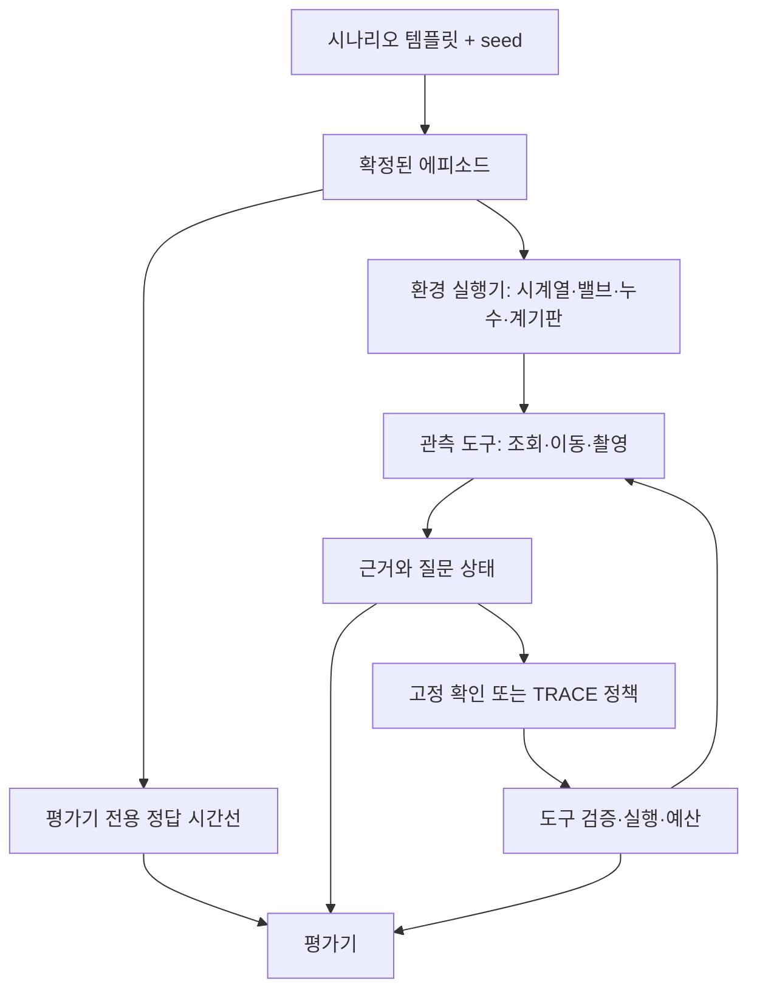

# TRACE 아키텍처 제안 — 펌프 합성 에피소드와 능동 확인 실험

- 작성일: 2026-10-30, Asia/Seoul
- 상태: **제안 — 이 문서의 신규 구조는 아직 구현하지 않음**
- 이전 제안: 이 폴더의 첫 기록
- 목적: 대화에서 합의 중인 설계 방향을 보존하고 이후 아키텍처 변화의 비교 기준으로 사용한다.
- 기존 요구사항: [implementation_guide.md](../../implementation_guide.md). 이 제안은 원본 요구사항을 수정하지 않는다.

## 1. 연구질문과 실험 범위

유사한 시계열 관측을 만드는 여러 원인이 있을 때, 에이전트가 원인을 구별하는 추가 계측·시각 관측을 선택하면 동일한 예산에서 잘못된 진단을 줄일 수 있는가?

첫 대상은 펌프·밸브·계기판·누수 관측부가 있는 Isaac Sim 장면이다. 사용자가 파이프 관측부에서 물방울이 떨어지는 시각 효과를 구현했다고 설명했다. 해당 구현의 파일 경로와 API는 아직 확인하지 않았으므로 연결 지점을 조사해야 한다.

첫 실험은 **관측 전용**이다. 시계열 리플레이와 합성 사건을 동기화하고 에이전트는 이동·촬영·계기 확인·기록 조회·진단·인계를 수행한다. 밸브를 조작해 공정 상태를 복구하는 제어 실험은 포함하지 않는다. 기록 재생은 새로운 제어 입력에 따른 공정 응답을 제공하지 않기 때문이다.

합성 조건은 명시적으로 기록한다. 실험 내 일관성과 재현성을 검증하는 것이 첫 목표이며, 실제 펌프 유체역학이나 현장 안전성을 검증했다는 주장을 하지 않는다.

## 2. 제안 당시의 기존 구현

2026-10-30 코드 검토 기준:

- `src/haiclaw/harness.py`: 모델 도구 선택, 실행, 예산, 취소, 실패 피드백, 이력 기록이 존재한다.
- `src/haiclaw/providers/harness_planner.py`: Qwen이 허용된 도구와 대상을 선택한다. 질문 목록은 `presence/lying`에 고정돼 있다.
- `src/haiclaw/context.py`: 근거 만료·철회·충돌과 의존 판단의 재개방을 지원하지만 사람 존재·자세에 특화돼 있다.
- `src/haiclaw/tool_contracts.py`: `Planner`와 `InspectionTools` 계약이 있으나 관측 반환형이 사람 영상 해석에 결합돼 있다.
- `src/haiclaw/core.py`: 근거 구조와 사건 상태가 있지만 `Incident.accept`의 판단은 작업자 상황에 특화돼 있다.
- CPU 회귀 테스트 122개 통과 기록이 있다. 이는 펌프 실험이나 신규 구조의 검증이 아니다.
- 당시 설정된 로컬 모델 주소 `127.0.0.1:11435`는 연결되지 않았다. 새로운 실제 모델 실험 전에 연결 확인이 필요하다.

따라서 펌프 도구만 추가하는 것으로 충분하지 않다. 실행 제어와 작업별 근거·종료 규칙을 분리해야 한다.

## 3. 설계 원칙

1. **환경·관측·정책·평가 분리:** 같은 사건에서 정책만 바꾸어 비교한다.
2. **정답 격리:** 환경 생성기와 평가기는 숨겨진 원인을 알지만 planner는 도구로 얻은 정보만 받는다.
3. **관측과 해석 분리:** 이미지·수치 기록과 그로부터 얻은 명제를 별도로 보관한다.
4. **근거 출처 보존:** 같은 센서의 숫자와 계기판 이미지를 독립된 확인으로 중복 계산하지 않는다.
5. **공통 시계:** 사건, 시계열, 영상, 도구 비용을 하나의 에피소드 시간축으로 연결한다.
6. **기존 작업 보존:** 작업자 확인을 기본 작업 모듈로 유지하고 펌프 작업을 추가한다.
7. **작은 첫 구현:** 범용 그래프 프레임워크나 새 월드모델 학습보다 첫 비교실험을 우선한다.

## 4. 전체 구조



환경의 `leak.active=True`는 관측 결과가 아니다. `inspect(pipe_joint)`는 이동 결과를 반환하고, 후속 `observe(body)`가 실제 영상을 확보한다. 영상 해석기가 관측 가능한 물방울을 보고해야 한다. CPU fixture가 만든 관측과 실제 Isaac 영상·모델 추론은 별도 검증 수준으로 기록한다.

## 5. 제안 파일 구조

다음은 예정 구조이며, 기존 파일을 이미 옮겼다는 뜻이 아니다.

```text
src/haiclaw/
├── harness.py                 # 공통 실행·예산·취소·실패 처리
├── tool_contracts.py          # 도구 요청과 응답 계약
├── evidence.py               # 공통 근거·출처·시간·의존 관계
├── tasks/
│   ├── worker.py             # 기존 사람 존재·자세·종료 규칙
│   └── pump.py               # 펌프 질문·가설·근거 인정·종료 규칙
├── experiments/
│   ├── episode.py            # 템플릿 샘플링·확정 명세·검증
│   ├── runtime.py            # 시계·이벤트·리플레이 실행
│   └── evaluator.py          # 정답 대조·정책별 지표
└── providers/
    ├── pump_tools.py         # 시계열 조회·이동·촬영
    ├── pump_scene.py         # 기존 Isaac 장면과 효과 연결
    └── ...                   # 기존 planner·영상 해석기
```

`Evidence`를 이동할 때 기존 import 호환성을 유지한다. `Harness`의 사람 전용 분기를 작업 모듈로 옮기되 기본 동작은 `WorkerTask`로 보존한다. 작업별 도구와 질문 목록은 계약으로 제공하고 planner schema의 고정 목록도 그에 맞게 바꾼다. 기존 `context.py`의 공통 수명주기 로직을 얼마나 추출할지는 구현 시 결정하며, 첫 버전에서 자유로운 DAG 생성을 요구하지 않는다.

## 6. 에피소드 명세

템플릿에는 값의 범위·분포·제약을 둔다. 실행 전 샘플링한 결과를 확정 manifest로 저장한다. 동일 manifest를 여러 정책에 사용한다.

아래 YAML은 형식 제안용 예시이며 아직 로더가 구현된 실행 설정이 아니다.

```yaml
schema_version: 1
episode_id: pump_0042
seed: 42
task: diagnose_pump_anomaly
mode: observation_only

timeline:
  duration_s: 90
  replay_rate: 1.0

telemetry:
  source: prepared_trace_07
  start_sample: 1200
  channel_map: pump_station_v1

events:
  - at_s: 25
    kind: physical_leak
    target: pipe_joint_a
    severity: small

observations:
  initial_channels: [pressure_main]
  inspectable_targets: [pipe_joint_a, valve_a, gauge_backup]

budget:
  deadline_s: 60
  max_tool_calls: 8

evaluation:
  truth_schedule: generated
  required_output: diagnosis_with_evidence
```

최종 명세에는 원본 파일 해시·구간·샘플 주기·단위·변환 규칙, 실제 선택된 파라미터, 장면·생성기·정책·모델 버전을 추가한다. 에피소드 시작과 사건 발생 중 어느 시점부터 대응 예산을 계산하는지 명시한다. 위 값은 예시이며 확정된 실험 조건이 아니다.

manifest 전체를 planner에 전달하지 않는다. 공개 작업 정보, 실제 조회한 관측, 현재 사용 가능한 도구, 남은 예산만 별도 context로 구성한다. 원인 이름이 포함된 파일 경로나 episode 이름도 모델 입력에서 제외한다.

`physical_leak` 이벤트는 선택된 시계열 구간·합성 변환·시각 표현의 호환성을 검사하고 실행한다. 연결 규칙이 없는 조합은 생성 단계에서 거부한다. 원본에 없는 원인·효과 연결은 합성 가정으로 표시한다.

## 7. 근거·질문·가설·진단

공통 근거에는 ID, episode, 대상, 출처, 촬영/측정 시각, 수신 시각, 원본 참조와 `lineage`를 둔다. 해석 결과는 근거 ID를 참조하는 별도 `Finding`으로 표현한다.

```python
# 제안 계약의 개념 예시
Evidence(
    id="e17", source="body_camera", subject="pipe_joint_a",
    capture_time=37.2, received_time=38.1,
    artifact="frame_0017.png", lineage=["body_camera"],
)
Finding(
    evidence_ids=["e17"], claim="visible_dripping",
    value=True, limitations=[],
)
```

계기판이 압력 센서의 재표시라면 그 센서를 계보에 포함한다. 계보는 데이터 흐름 정보이며 현재 고장 여부의 정답을 알려주는 필드가 아니다.

| 층 | 예시 |
|---|---|
| 관측 질문 | 압력 변화, 관측 가능한 물방울, 밸브 위치 |
| 원인 가설 | 누수, 밸브 이상, 계측 오류 |
| 진단 응답 | 지지하는 가설, 근거 참조, 미확인 사항 |

물방울 미검출만으로 누수 부재나 계측 오류를 확정하지 않는다. 가림·불충분한 관측 시간은 미해결 사유다. 모델은 도구를 선택하고 진단을 제안하며, 호스트는 근거 유효성과 종료 조건을 검사한다. 실제 정답 여부는 평가기가 따로 계산한다. 호스트가 허용한 진단을 자동으로 정답 처리하지 않는다.

## 8. 시간과 관측 도구

- 모든 조회는 공통 에피소드 시계를 사용한다. 시계열은 현재까지의 데이터만 제공한다.
- 이동·추론 중에도 선택된 시간 운용 방식에 따라 사건이 진행한다. 모델 호출 때 리플레이를 초기화하지 않는다.
- 촬영/측정 시각과 수신 시각을 모두 남긴다. 다른 정책이 늦게 도착하면 해당 시점의 장면을 관측한다.
- CPU 시험의 설정된 도구 비용과 실제 Isaac 실행의 소요시간은 혼합하지 않는다.
- 시뮬레이션 시간과 wall time을 함께 기록하고, 정지·리셋·늦은 응답 처리에는 기존 하네스 계약을 유지한다.
- 첫 도구는 시계열 조회, 등록된 확인 위치 이동, 영상 촬영, 미확인 인계로 제한한다. 공정 조작 도구는 추가하지 않는다.

## 9. 에피소드 다양화와 평가

첫 조건은 정상, 누수, 계측 오류, 확인 불가다. 누수와 계측 오류는 최초 관측이 비슷하지만 추가 근거로 구별되는 쌍으로 구성한다. 구별 불가능한 경우도 포함하고 미확인 인계가 허용되는 조건을 명시한다. 밸브 이상은 다음 확장 후보이며 첫 완료 기준에 필수로 넣지 않는다.

다양화 축을 분리한다.

- 원인과 운전 조건: 사건 종류, 발생 시점, 강도, 데이터 구간.
- 관측 조건: 위치, 거리, 각도, 조명, 가림, 지연.

고정 순서 확인과 TRACE 적응형 확인에 동일 도구·예산·근거 및 종료 규칙을 제공한다. 근거 관리 자체의 효과는 별도 제거 실험으로 분리한다. 원본 구간과 시나리오 계열 단위로 개발/평가를 나눠 유사 변형 누출을 막는다.

필수 결과는 진단 정답 여부, 잘못된 확정, 미확인 인계, 판단 시간, 이동·관측·조회 비용, 도구 실패와 시간 초과다. 실패한 에피소드를 제외하지 않으며 항상 인계하는 정책이 유리해지지 않도록 정답률과 완료·비용 지표를 함께 보고한다. 식별 가능한 조건과 불가능한 조건을 구분한다.

## 10. 구현 순서와 완료 기준

1. 기존 누수 장면 API와 모델 연결을 확인한다.
2. 작업자 전용 규칙을 분리하고 기존 회귀 동작을 보존한다.
3. episode 명세·공통 시계·CPU 도구로 네 조건을 생성한다.
4. 고정 확인과 TRACE를 동일 명세에서 실행하고 독립 평가 결과를 만든다.
5. Isaac의 밸브·누수·계기판과 실제 영상 해석을 연결해 별도 검증한다.

첫 완료 기준은 **네 조건 × 두 정책을 재현 가능하게 실행하고 실패를 포함한 결과표를 생성하는 것**이다. 반복 수와 통계적 충분성은 파일럿 이후 결정한다.

핵심 검증:

- 숨겨진 정답·미래 데이터가 agent context에 유입되지 않는다.
- 사건과 시계열·렌더 상태가 같은 시간축을 사용한다.
- 같은 센서의 재표시를 독립 근거로 계산하지 않는다.
- stale/duplicate/다른 episode의 근거를 거부한다.
- 실제 영상과 설정한 관측 가능 조건이 부합한다.
- 고정 정책과 TRACE가 동일한 도구·예산·판정 규칙을 사용한다.
- 작업자 확인의 기존 동작이 유지된다.

## 11. 선택 이유와 보류한 대안

이 구조는 환경과 평가기를 유지한 채 정책·추정 방법만 교체할 수 있다. 이후 센서 배제, 가상계측, JEPA 예측기를 붙여도 동일 사건과 관측 조건에서 비교할 수 있다.

- 펌프 조건을 기존 사람 전용 분기에 계속 추가하는 방식은 보류한다. 과제별 의미와 공통 실행 제어가 뒤섞인다.
- 첫 단계의 유체 시뮬레이션 구현은 보류한다. 현재 질문은 관측 선택과 진단이며, 리플레이 기반 환경으로 먼저 검증한다.
- 자유로운 질문 생성·범용 DAG·신규 월드모델 학습은 보류한다. 첫 비교에 필수적이지 않다.
- 리플레이만으로 밸브 조작의 제어 효과를 평가하지 않는다. 그 단계에서는 별도 동역학 연결이 필요하다.

## 12. 남은 결정

- 누수 코드와 펌프 에셋의 실제 경로·조작 인터페이스.
- 첫 리플레이 데이터와 채널·단위·사건 매핑. SWaT/GHL은 후보이며 아직 확정하지 않았다.
- 합성 누수와 수치 신호를 연결할 명시적 생성 규칙.
- 실제 센서와 표시값의 계보 및 독립 관측 범위.
- 실제 상태 변화와 모순된 근거를 구분하는 규칙, 진단 제출·종료 계약.
- 시뮬레이션과 모델 추론의 시간 진행 정책, 기한의 기준 시점.

## 13. 설계 참고

아래는 방법론 참고이며 이 제안이 해당 표준을 구현하거나 준수한다는 뜻은 아니다.

- [Scenic](https://scenic-lang.org/cps25/): 분포·공간 및 시간 제약에 기반한 시나리오 생성.
- [CATS 데이터셋](https://zenodo.org/records/8338435): 제어된 이상 주입, 원인·영향 채널과 사건 메타데이터.
- [ASAM OpenSCENARIO](https://openscenario.asam.net/ASAM_OpenSCENARIO_DSL/v2.0.0/introduction.html): 기본 시나리오와 파라미터 변형을 분리하는 명세 접근. 교통 분야 중심.

