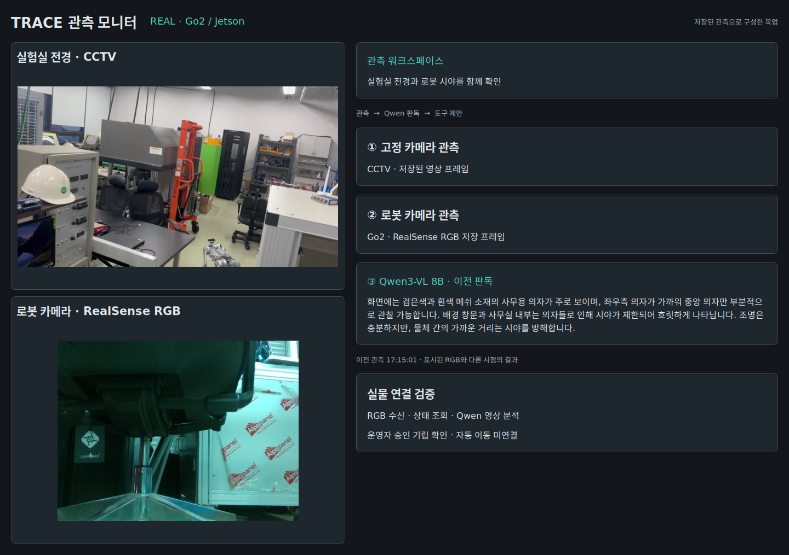

# Go2 live monitor

The Go2 monitor brings TRACE's observation side onto a real Unitree Go2 EDU. A Jetson on the robot streams RealSense video and Go2 state to the DGX Spark, where Qwen3-VL 8B describes the latest frame. Motion control from TRACE is the next step.



*Robot RealSense view, CCTV view of the lab and Qwen3-VL panel, composited for presentation.*

## Setup

```
Go2 control PC ──LAN── Jetson (RealSense, bridge) ──Tailscale── DGX Spark (monitor, Qwen3-VL on Ollama)
```

- **Camera:** RealSense RGB attached to the Jetson (`/dev/video4`), 640×480, up to 10 fps.
- **Telemetry:** Go2 `SportModeState` through the Jetson bridge, about 1–3 ms old on arrival.
- **Model:** Qwen3-VL 8B on the Spark's local Ollama (port 11434). One request at a time; a response takes about 7.5 s. Stale frames are rejected.
- **Robot actions so far:** a confirmed `stand_up` (body height 0.076 m → 0.329 m, held steady). No walking commands are sent from the monitor.
- **CCTV:** the monitor can loop recorded lab videos from local files.

## Run

From the repository root on the Spark desktop:

```bash
/usr/bin/python3 scripts/monitor_go2_ui.py
```

The same panel appears under **Go2 실시간** in `scripts/trace_desktop.py` (click **스트림 연결**). Run one camera consumer at a time.

Read-only snapshot and state capture:

```bash
PYTHONPATH=src python3 -m tracebot.providers.go2_readonly
```

SSH to the Jetson must already be set up. The bridge configuration lives on the Jetson at `/home/unitree/go2_bridge_project/config/bridge.env`; adjust it and the camera device for another robot. The bridge is reached over SSH, so no extra port is exposed.

## Next

- Connect TRACE's `observe` / `inspect` / `stop` tools to the Go2 bridge, starting with in-place turns toward named viewpoints.
- Hardware timestamps, depth, obstacle avoidance and automatic reconnect.
