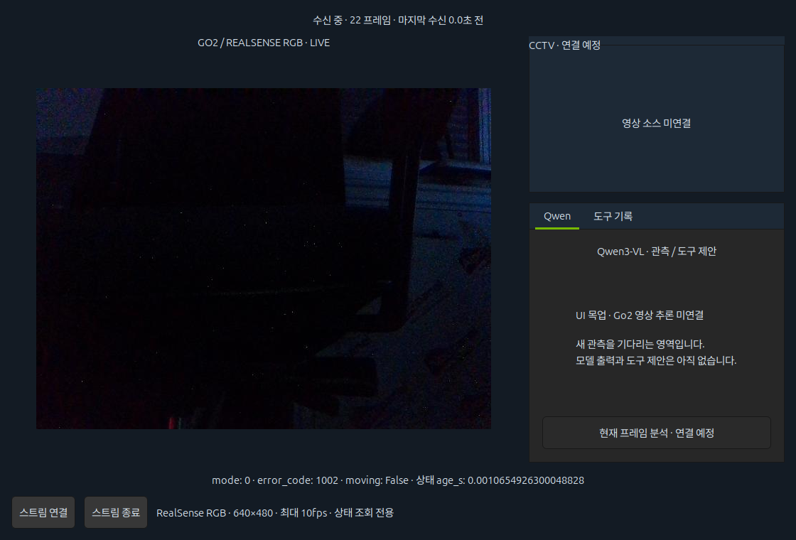

# Go2 live monitor — 2026-11-16

TRACE now includes a read-only Go2 monitor alongside its existing simulation workflow. This real-hardware addition was explicitly requested by the operator. The original simulation implementation guide remains unchanged.



## Verified on hardware

- Tailscale SSH connects Spark to the Jetson. The HTTP bridge health and authenticated state requests succeed.
- SportModeState arrives with approximately 1–3 ms age at the bridge.
- Jetson-attached RealSense RGB frames arrive at 640×480 over a persistent SSH connection, capped at 10 fps. This is not the Go2 built-in camera.
- The monitor refreshes telemetry once per second and displays stale/disconnected camera status.
- With operator confirmation of clearance, one `stand_up` request was sent. Reported body height rose from 0.076 m to 0.329 m and stayed there through eight one-second samples. No walking command was sent.
- `error_code` changed from 1001 to 1002; its firmware-specific meaning is unverified. `moving: false` is the bridge command bookkeeping field, not independent proof that the robot cannot move.

## Screen scope

The camera and telemetry are live. **Qwen and CCTV are UI placeholders.** The Qwen tab has no generated response, the analysis button is disabled, and CCTV has no connected source. No autonomous navigation or model tool execution is implemented. The screenshot is a presentation mockup containing a real camera frame, not evidence of Qwen inference.

## Run

From the repository root, on the Spark desktop with system GTK installed:

```bash
/usr/bin/python3 scripts/monitor_go2_ui.py
# Optional: capture the app widget after 20 received frames
/usr/bin/python3 scripts/monitor_go2_ui.py --capture-mockup
```

The same component appears under **Go2 실시간** in `scripts/trace_desktop.py`. Click **스트림 연결** there. Run only one camera consumer at a time. Close the standalone monitor before connecting from the full app.

Read-only snapshot and state capture:

```bash
PYTHONPATH=src python3 -m tracebot.providers.go2_readonly
```

SSH must already be authenticated. The current deployment uses the Jetson project configuration at `/home/unitree/go2_bridge_project/config/bridge.env` and RealSense `/dev/video4`; adapt those deployment defaults for another robot. Tokens are read on Jetson and never copied into this repository or displayed. The bridge is accessed locally from Jetson through SSH; no new public camera port is opened.

## Validation and limits

Python compilation passed for the new monitor, snapshot provider, and modified main desktop module. Live streaming was observed beyond 123 frames. The standalone component was launched and captured; the entire simulation desktop was not relaunched or revalidated. Hardware timestamps, depth sensing, obstacle avoidance, automatic reconnect, and Qwen-to-Go2 motion integration remain future work. The displayed camera age measures time since local receipt, not sensor exposure time.
